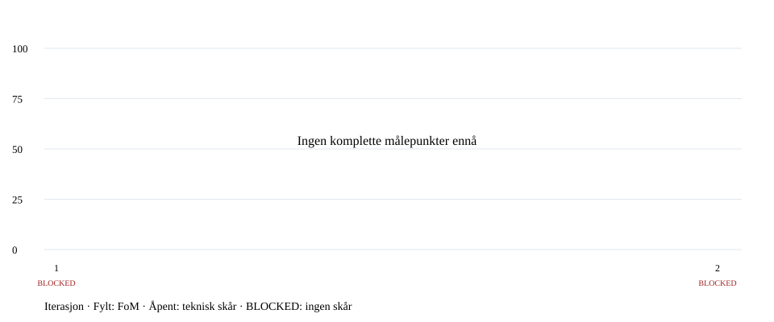

# Appens FoM-historikk

[HTML-oversikt](index.html) · [Kjøreguide og skårformel](README.md)

F = funksjonstester, P = benchmarkytelse, U = brukeropplevelse (alle 0–100). Vektene står i hver rapport. Bare sammenlignbare målinger kobles i grafen.

| # | Iterasjon / rapport | Tid (UTC) | F | P | U | FoM | Status |
| --- | --- | --- | ---: | ---: | ---: | ---: | --- |
| 1 | [test av test](runs/20261030T120722.830254Z/report.md) | 2026-10-30T12:07:23.417469+00:00 | 100.00 | 100.00 | 60.00 | — | BLOCKED |
