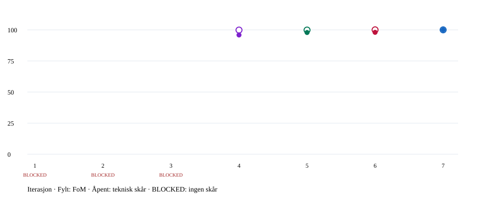

# Appens FoM-historikk

[HTML-oversikt](index.html) · [Kjøreguide og skårformel](README.md)

F = funksjonstester, P = benchmarkytelse, U = brukeropplevelse (alle 0–100). Vektene står i hver rapport. Bare sammenlignbare målinger kobles i grafen.

| # | Iterasjon / rapport | Tid (UTC) | F | P | U | FoM | Status |
| --- | --- | --- | ---: | ---: | ---: | ---: | --- |
| 1 | [02 test fførste iterasjon](runs/20261030T134157.523334Z/report.md) | 2026-10-30T13:41:57.880693+00:00 | 100.00 | 100.00 | — | — | BLOCKED |
| 2 | [funker ikke](runs/20261030T134504.669991Z/report.md) | 2026-10-30T13:45:04.832725+00:00 | 100.00 | 100.00 | 50.00 | — | BLOCKED |
| 3 | [2026-11-04 – Micro Racer etter evalueringsrettelse](runs/20261104T083902.338210Z/report.md) | 2026-11-04T08:39:02.598624+00:00 | 100.00 | 100.00 | — | — | BLOCKED |
| 4 | [2026-11-04 – Micro Racer med rettet evalueringsverktøy](runs/20261104T084043.311188Z/report.md) | 2026-11-04T08:40:43.469866+00:00 | 99.73 | 100.00 | 80.00 | 95.86 | COMPLETE |
