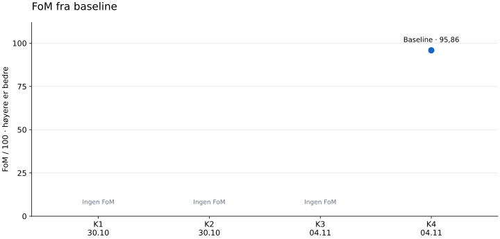
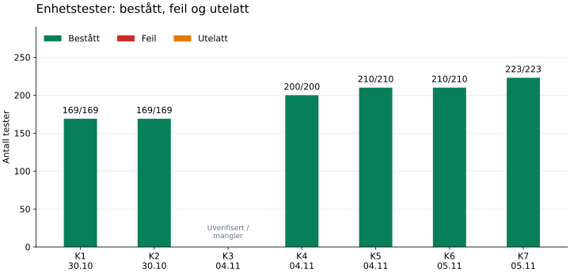

# Resultatutvikling

Vi har 4 komplette FoM-målinger fordelt på 4 serier. Første komplette punkt i hver serie er baseline. Bare punkter med samme målegrunnlag kobles sammen.

[Åpne den interaktive oversikten](index.html) · [Detaljert historikk](history.md)

## 1. FoM – samlet kvalitet

Høyere er bedre. FoM kombinerer funksjonstester (50 %), benchmarkytelse (30 %) og brukeropplevelse (20 %). En komplett måling kan fortsatt ha feil. Avbrutte kjøringer er ikke null poeng.

| Kjøring | FoM / 100 | Funksjon / 100 | Ytelse / 100 | Brukerskår / 10 | Forklaring |
| --- | --- | --- | --- | --- | --- |
| [K1 · 2026-10-30 13:41 UTC](runs/20261030T134157.523334Z/report.md) | — | Ufullstendig | Ufullstendig | — | Ufullstendig kjøring |
| [K2 · 2026-10-30 13:45 UTC](runs/20261030T134504.669991Z/report.md) | — | Ufullstendig | Ufullstendig | 5,0 | Ufullstendig kjøring |
| [K3 · 2026-11-04 08:39 UTC](runs/20261104T083902.338210Z/report.md) | — | Ufullstendig | Ufullstendig | — | Måleverktøyets egenkontroll feilet / mangler |
| [K4 · 2026-11-04 08:40 UTC](runs/20261104T084043.311188Z/report.md) | 95,86 | 99,73 | 100,00 | 8,0 | Komplett måling · Baseline for serien · 1 testgruppe med feil |
| [K5 · 2026-11-04 19:00 UTC](runs/20261104T190015.637939Z/report.md) | 97,86 | 99,73 | 100,00 | 9,0 | Komplett måling · Baseline for serien · 1 testgruppe med feil |
| [K6 · 2026-11-05 11:39 UTC](runs/20261105T113906.475080Z/report.md) | 98,00 | 100,00 | 100,00 | 9,0 | Komplett måling · Baseline for serien |
| [K7 · 2026-11-05 19:28 UTC](runs/20261105T192832.581524Z/report.md) | 100,00 | 100,00 | 100,00 | 10,0 | Komplett måling · Baseline for serien |

### Den tidligere tekniske baselinen

Det finnes også en eldre teknisk baseline fra 2026-10-30: teknisk skår 100,00/100, FoM —. Den mangler brukerskår. Dette er et arkivert sammendrag fra en annen maskin (AMD Ryzen 7 7435HS), ikke en ny kjøring. Den kobles ikke til punktene ovenfor.

[Lagret målesammendrag](baseline-summary-2026-10-30.json) · [Første verifisering](validation-2026-10-30.md)

## 2. Enhetstester – antall og resultat

Første registrerte enhetstestmåling: 169/169. Siste: 223/223. Antall tester har endret seg med +54. Siste måling har 0 feil og 0 utelatte tester. Den arkiverte tekniske baselinen hadde også 169/169 enhetstester bestått.

Her teller vi enhetstestene for webapp, inputbibliotek og backend. Tallene er bestått / antall tester. Firmware, integrasjon, nettleserforløp og måleverktøyets egenkontroll vises separat i detaljrapportene. Flere tester viser et større testsett, ikke automatisk bedre kode eller høyere testdekning.

| Kjøring | Webapp og spill | Inputbibliotek | Backend | Totalt bestått / antall | Feil | Utelatt | Datagrunnlag |
| --- | --- | --- | --- | --- | --- | --- | --- |
| K1 · 2026-10-30 13:41 UTC | 58/58 | 39/39 | 72/72 | 169/169 | 0 | 0 | Gjennomført; samlet kjøring ufullstendig |
| K2 · 2026-10-30 13:45 UTC | 58/58 | 39/39 | 72/72 | 169/169 | 0 | 0 | Gjennomført; samlet kjøring ufullstendig |
| K3 · 2026-11-04 08:39 UTC | 89/89 | 39/39 | 72/72 | 200/200 | 0 | 0 | Uverifiserte / manglende tall |
| K4 · 2026-11-04 08:40 UTC | 89/89 | 39/39 | 72/72 | 200/200 | 0 | 0 | Gjennomført |
| K5 · 2026-11-04 19:00 UTC | 95/95 | 39/39 | 76/76 | 210/210 | 0 | 0 | Gjennomført |
| K6 · 2026-11-05 11:39 UTC | 95/95 | 39/39 | 76/76 | 210/210 | 0 | 0 | Gjennomført |
| K7 · 2026-11-05 19:28 UTC | 102/102 | 45/45 | 76/76 | 223/223 | 0 | 0 | Gjennomført |

## 3. Benchmarks – faktisk kjøretid

I siste komplette FoM-måling ligger 14 av 14 benchmarkprofiler innenfor tidsbudsjettet. Se utviklingen for hver profil nedenfor; ikke sammenlign ulike arbeidsmengder direkte.

Lavere p95 i millisekunder er bedre: 95 % av prøvene var like raske eller raskere enn dette. Vi viser rå tid fordi ytelsesskåren stopper på 100 når budsjettet er nådd. To målinger kan derfor få 100 poeng og likevel ha forskjellig kjøretid.

Tall fra fullførte delmålinger i avbrutte kjøringer vises med åpne punkter. Tall fra en kjøring der måleverktøyets egenkontroll feilet, er merket uverifisert og utelates fra grafene. Bare samme serie kobles med linjer. Endret testgrunnlag eller miljø gir ny serie; forskjeller alene beviser ikke at produktet ble raskere. Dette måler CPU-arbeid og input med testdata, ikke FPS, fysisk USB eller responstid over internett.

| Profil | Budsjett ms | Arkivbaseline p95 ms | K1 p95 ms | K2 p95 ms | K3 p95 ms | K4 p95 ms | K5 p95 ms | K6 p95 ms | K7 p95 ms |
| --- | --- | --- | --- | --- | --- | --- | --- | --- | --- |
| [Node · 50 Hz · 1 abonnent](benchmark-01.svg) | 5,0000 | 0,0237 | 0,0274 * | 0,0272 * | 0,0277 † | 0,0265 | 0,0243 | 0,0276 | 0,0247 |
| [Node · 50 Hz · 4 abonnenter](benchmark-02.svg) | 5,0000 | 0,0249 | 0,0220 * | 0,0216 * | 0,0217 † | 0,0217 | 0,0220 | 0,0220 | 0,0218 |
| [Node · 500 Hz · 1 abonnent](benchmark-03.svg) | 5,0000 | 0,0229 | 0,0201 * | 0,0203 * | 0,0194 † | 0,0205 | 0,0195 | 0,0198 | 0,0196 |
| [Node · 500 Hz · 4 abonnenter](benchmark-04.svg) | 5,0000 | 0,0225 | 0,0203 * | 0,0203 * | 0,0195 † | 0,0207 | 0,0195 | 0,0197 | 0,0198 |
| [Micro Snake](benchmark-05.svg) | 16,6667 | 0,0728 | 0,0305 * | 0,0356 * | 0,0374 † | 0,0375 | 0,0477 | 0,0382 | 0,1729 |
| [Viking Dash](benchmark-06.svg) | 16,6667 | 0,0442 | 0,0508 * | 0,0545 * | 0,0539 † | 0,0534 | 0,0585 | 0,0549 | 0,0577 |
| [Stjernefangst](benchmark-07.svg) | 16,6667 | 0,0173 | 0,0510 * | 0,0465 * | 0,0504 † | 0,0537 | 0,0523 | 0,0459 | 0,0348 |
| [Reaksjonsjakt](benchmark-08.svg) | 16,6667 | 0,0031 | 0,0044 * | 0,0050 * | 0,0050 † | 0,0049 | 0,0058 | 0,0058 | 0,0060 |
| [Balanseløypa](benchmark-09.svg) | 16,6667 | 0,0097 | 0,0144 * | 0,0154 * | 0,0154 † | 0,0168 | 0,0222 | 0,0162 | 0,0236 |
| [Micro Tetris](benchmark-10.svg) | 16,6667 | 0,1035 | 0,0942 * | 0,1030 * | 0,1054 † | 0,1014 | 0,1078 | 0,1069 | 0,1032 |
| [Chromium · 50 Hz · 1 abonnent](benchmark-11.svg) | 5,0000 | 0,1000 | — | — | — | 0,1000 | 0,1000 | 0,1000 | 0,1000 |
| [Chromium · 50 Hz · 4 abonnenter](benchmark-12.svg) | 5,0000 | 0,1000 | — | — | — | 0,1000 | 0,1000 | 0,1000 | 0,1000 |
| [Chromium · 500 Hz · 1 abonnent](benchmark-13.svg) | 5,0000 | 0,1000 | — | — | — | 0,1000 | 0,1000 | 0,1000 | 0,1000 |
| [Chromium · 500 Hz · 4 abonnenter](benchmark-14.svg) | 5,0000 | 0,1000 | — | — | — | 0,1000 | 0,1000 | 0,1000 | 0,1000 |

Kolonnen «Arkivbaseline» er fra det tidligere målesammendraget på en annen PC. Den er en referanse, ikke et punkt i disse grafene eller bevis for en ytelsesforbedring.

Klikk på en profil for grafen. * Fullført delmåling i ufullstendig kjøring. † Uverifisert, ikke et grafpunkt. — Ikke målt.

Micro Racer har foreløpig ingen CPU-benchmarkprofil.

## Nyeste publiseringskontroll – separat fra FoM

2026-11-05: versjon d54d0123 er publisert. Dette er avgrensede kontroller før og etter utrulling, ikke en ny full evaluering. FoM-grafen endres først etter ny evaluering og brukervurdering.

| Kontroll | Resultat | Forklaring |
| --- | --- | --- |
| Enhetstester / input | 223/223 bestått | 102 webapp, 45 inputbibliotek og 76 backend. |
| Nettleser | 62/62 app; 10/10 input | Tetris-styring, canvas, lyd, tilkobling og øvrige brukerforløp. |
| SDK og spillisolasjon | 13/13 bestått | Separat kontroll; ingen ekstra FoM-poeng. |
| Spillkatalog | 47 varianter bevart og synkronisert | Samme ID-er og poengregler; nye innholdshasher kontrollert i API-et. |
| Publisert nettside | 120 filer; 7 spill; 47 topplister | SHA-256, HTTPS, mobilvisning, bilder og seks tjenester kontrollert. |

Ingen produktavvik påvist. Første offentlige nettleserprobe leste bildestatus før innlasting; kontroll med eksplisitt venting bestod. Første feil og oppfølging er dokumentert.

Fysisk USB, ekte Qwen og lang backendprofil ble ikke kjørt på nytt. Komplett lokal appevaluering 20261105T192832.581524Z har FoM 100,00 med Martins nye brukerskår 10/10; den vises separat i historikken.

[Full utrullingsrapport](../../verification/frontend-publication-2026-11-05.md)

## Kjøringer og sammenlignbarhet

- **K1 · 2026-10-30 13:41 UTC**: [02 test fførste iterasjon](runs/20261030T134157.523334Z/report.md), commit `0658e3e2`, serie `dd4fe64446c1`. Ufullstendig kjøring.
- **K2 · 2026-10-30 13:45 UTC**: [funker ikke](runs/20261030T134504.669991Z/report.md), commit `0658e3e2`, serie `dd4fe64446c1`. Ufullstendig kjøring.
- **K3 · 2026-11-04 08:39 UTC**: [2026-11-04 – Micro Racer etter evalueringsrettelse](runs/20261104T083902.338210Z/report.md), commit `f77aedea`, serie `f9491acd0594`. Måleverktøyets egenkontroll feilet / mangler.
- **K4 · 2026-11-04 08:40 UTC**: [2026-11-04 – Micro Racer med rettet evalueringsverktøy](runs/20261104T084043.311188Z/report.md), commit `f77aedea`, serie `a8a78ef6f9ea`. Komplett måling.
- **K5 · 2026-11-04 19:00 UTC**: [02 – spillisolasjon og SDK](runs/20261104T190015.637939Z/report.md), commit `b48b42ed`, serie `7b4225da7b54`. Komplett måling.
- **K6 · 2026-11-05 11:39 UTC**: [03 – kontrollert tidspunkt i Viking-lydtesten](runs/20261105T113906.475080Z/report.md), commit `f6730683`, serie `754257955077`. Komplett måling.
- **K7 · 2026-11-05 19:28 UTC**: [04 – Tetris-styring, spillflate og tilkobling](runs/20261105T192832.581524Z/report.md), commit `d54d0123`, serie `216cc22a506d`. Komplett måling.

K betyr kjøring, ikke forbedringsrunde. Flere kjøringer kan tilhøre samme kodeversjon. En serie har samme testgrunnlag, profil, miljø og skårformel. Den eldre backend-FoM-en bruker en annen formel og inngår ikke i appens utviklingskurve.

[Tidligere backendmålinger](../README.md) · [Målemetode](README.md)
