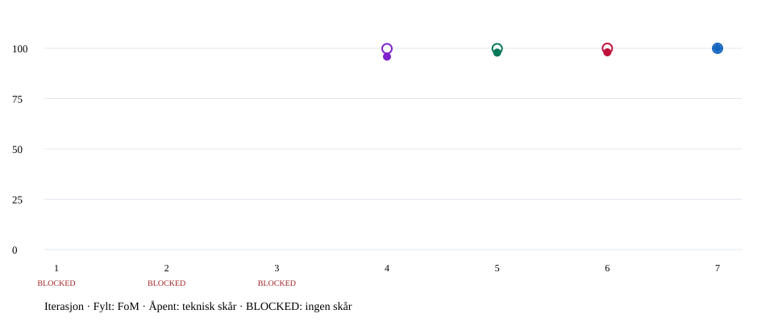

# 2026-11-04 – Micro Racer med rettet evalueringsverktøy

[Alle iterasjoner](../../history.md) · [HTML-rapport](report.html) · [Rårapport](report.json)

Kjøring: 20261104T084043.311188Z. Tid (UTC): 2026-11-04T08:40:43.469866+00:00.

Profil: local-browser. Serie: a8a78ef6f9ea. Commit: f77aedeab492f6c5837fd79f86cac2212932ece2. Lokale endringer: True.



## Slik beregnes samlet FoM

**FoM = 50 % × F + 30 % × P + 20 % × U**, på skalaen 0–100.

| Del | Skår / 100 | Vekt | Vektet bidrag | Grunnlag |
| --- | ---: | ---: | ---: | --- |
| F – funksjon | 99.73 | 50 % | 49.86 | Lik vekt mellom funksjonsgruppene: enhetstester, integrasjon/nettleser og plattformens kapasitetskontroll. |
| P – benchmarks / ytelse | 100.00 | 30 % | 30.00 | Lik vekt mellom målte benchmarkgrupper; lik vekt mellom profilene i hver gruppe. |
| U – brukeropplevelse | 80.00 | 20 % | 16.00 | Siste fullførte UX-skår multiplisert med 10. |

**Samlet FoM: 95.86 / 100 · COMPLETE.**

Teknisk skår uten UX: 99.83 / 100. Den normaliserer F og P etter deres samlede vekt og er et eget, åpent punkt i grafen.

Hver funksjonsgruppes skår er beståttandel × 100. Kapasitetskontrollen gir 100 ved PASS og 0 ved FAIL. Hver ytelsesprofil får `100 × min(1, budsjett / målt p95)`, med 100 ved målt null.

Målte feil (FAIL) trekker skåren ned og beholdes i grafen. BLOCKED betyr at en måling mangler eller ikke kan stoles på; da beregnes ingen samlet FoM. Delverdiene over kan være ufullstendige. UX fylles aldri inn automatisk.

Grupper i F: web-unit: 100.00, input-unit: 100.00, backend-unit: 100.00, firmware: 100.00, cross-component: 100.00, platform-capacity: 100.00, browser-app: 97.83, browser-input: 100.00.

Grupper i P: input-benchmark: 100.00, games-benchmark: 100.00, browser-performance: 100.00.

## Hva ble faktisk testet?

Levende API, PostgreSQL og Qwen i backend-testmiljø: **IKKE KJØRT**. Standardkjøringen bruker simulerte API-svar og Web Serial. Fysisk USB og produksjonsnettverk er ikke målt.

| Område | Status | Hva kontrolleres? | Testmiljø og avgrensning |
| --- | --- | --- | --- |
| Webapp og spillregler (web-unit) | PASS | API-klient, resultatkø og omforsøk, spillregister, spillmotorer og lyd/livssyklus. | JavaScript i Node; ingen nettleser, levende API eller fysisk micro:bit. |
| Inputbibliotek (input-unit) | PASS | Protokoll, meldingsframing, tilstand, knapper, sensorer, sesjoner og reconnect. | Simulert transport og klokke; ingen USB. |
| Backendregler (backend-unit) | PASS | Innlogging, validering, poeng/rangering, AI-samtale og tillatte databaseoppslag. | Enhetstester; ingen levende PostgreSQL eller Qwen. |
| Firmware på vertsmaskinen (firmware) | PASS | C++-kjerne, protokollfixtures og serialharness gjennom CTest. | Simulert maskinvare; ingen fysisk micro:bit. |
| Koblinger mellom komponenter (cross-component) | PASS | C++-meldinger gjennom ekte webapp-parser, kommando/kvittering og spillgrenser mot Python-validering. | Vertssimulator og testdata; ingen fysisk USB eller produksjonsdatabase. |
| Kapasitet og opptak (platform-capacity) | PASS | 50/500 Hz, bufferomløp og eksport. Korrekthetskravene inngår i F. | Akselerert logisk tid; rå CPU-tider har ikke eget ytelsesbudsjett. |
| Inputytelse i Node (input-benchmark) | PASS | 50/500 Hz × én/fire abonnenter; 300 sekunder logisk tid per profil etter oppvarming. | Fra komplett linje til callback; ingen USB eller nettverk. Budsjett hentes fra den lagrede målingen. |
| Spillsimulering på CPU (games-benchmark) | PASS | Fast seed, opprettelse og simuleringssteg; 100 oppvarminger og 1000 prøver per spill. | Ingen Canvas/GPU eller målt FPS. Budsjettet gjelder hele arbeidsmengden. |
| Brukerforløp i nettleseren (browser-app) | FAIL | Spillstart, pause/reconnect, poenginnsending, konto, Dashboard, topplister, AI-visning og mobiloppsett. | Chromium med simulerte API-svar og Web Serial; verifiserer ikke produksjonsinnlogging eller AI-svarkvalitet. |
| Input i nettleseren (browser-input) | PASS | Produksjonsadapter, native Streams, sesjoner, feil/opprydding og input-replay. | Chromium med simulert Web Serial; ingen fysisk USB. |
| Inputytelse i Chromium (browser-performance) | PASS | Samme fire replayprofiler med native Streams og lagrede percentiler. | Ingen fysisk USB eller nettverkslatens. |

### Individuelle testnavn fra lagrede resultater

Åpne gruppene nedenfor. Avbrutte kjøringer kan ha ufullstendige logger. Testlisten endrer ingen skår og er ikke et mål på kravdekning.

<details>
<summary>Webapp og spillregler: 89 registrerte testtilfeller</summary>

| Fil / suite | Testnavn | Resultat |
| --- | --- | --- |
|  | API sends same-origin cookies and exact POST header/body; handles 204 and non-JSON proxy errors | PASS |
|  | submission queue retains exact request after lost acknowledgement and blocks another owner | PASS |
|  | invalid result identity or contradictory record data never confirms saving | PASS |
|  | registry requires exact ID and scoring rules; snake score shows food before steps | PASS |
|  | snake relative steering accepts only first counted action; tail motion, walls and deterministic food | PASS |
|  | viking fixed simulation repeats seeded obstacles independently of rendering; B blocks jump | PASS |
|  | every registered game family loads its own playable module | PASS |
|  | extracted arcade modules retain round limits and completion semantics | PASS |
|  | TWEB-01/10: offentlige og beskyttede ruter | PASS |
|  | TWEB-02: samtlige startkrav må være oppfylt | PASS |
|  | TWEB-02: fornyelse ved fem minutter krever aktivt spill og input i synlig fane | PASS |
|  | TWEB-03: pause ved brudd og eksplisitt fortsett etter gjenoppkobling | PASS |
|  | TWEB-03: delverdier bruker ikke sluttverdigrenser | PASS |
|  | TWEB-04: sluttverdier er sikre heltall innen spillets grenser | PASS |
|  | TWEB-05/06: retry beholder eier, ID og eksakt body; annen konto sperres | PASS |
|  | TWEB-05: ulike forsøk med lik verdi har ulike ID-er | PASS |
|  | TWEB-04/05/06: bare 200/201 bekrefter lagring, konflikt beholder data | PASS |
|  | TWEB-09: AI har trimmet spørsmål, kodepunktgrenser og ingen historikk | PASS |
|  | MR-01/02/16 all 36 variants have stable unique IDs and exact scoring metadata | PASS |
|  | MR-15 race encoding prioritises place, rejects holes and formats without raw score leakage | PASS |
|  | MR-02/09 tracks are finite, their grids are safe and barriers surround both road edges | PASS |
|  | MR-03/05 vehicle profiles actually differ and braking takes precedence over throttle | PASS |
|  | MR-04 tilt has a continuous dead zone, signed saturation and relative turning | PASS |
|  | MR-06/17 held controls never arm from countdown, unavailable values or reconnect | PASS |
|  | MR-10 ordered finite gates reject backward crossings, false starts and shortcuts | PASS |
|  | MR-12 swept barriers and opposing cars cannot tunnel or generate collision energy | PASS |
|  | MR-09/14 recovery waits for a clear spawn and consumes exactly two active seconds | PASS |
|  | MR-13/14/15 ties, timeout and incomplete attempts obey the contract | PASS |
|  | MR-02/08/10 frozen trace: harbor-ring/drift | PASS |
|  | MR-02/08/10 frozen trace: harbor-ring/race | PASS |
|  | MR-02/08/10 frozen trace: harbor-ring/formula | PASS |
|  | MR-02/08/10 frozen trace: pine-valley/drift | PASS |
|  | MR-02/08/10 frozen trace: pine-valley/race | PASS |
|  | MR-02/08/10 frozen trace: pine-valley/formula | PASS |
|  | MR-02/08/10 frozen trace: neon-docks/drift | PASS |
|  | MR-02/08/10 frozen trace: neon-docks/race | PASS |
|  | MR-02/08/10 frozen trace: neon-docks/formula | PASS |
|  | MR-01/11/12 three-lap pack can finish: harbor-ring/drift | PASS |
|  | MR-01/11/12 three-lap pack can finish: harbor-ring/race | PASS |
|  | MR-01/11/12 three-lap pack can finish: harbor-ring/formula | PASS |
|  | MR-01/11/12 three-lap pack can finish: pine-valley/drift | PASS |
|  | MR-01/11/12 three-lap pack can finish: pine-valley/race | PASS |
|  | MR-01/11/12 three-lap pack can finish: pine-valley/formula | PASS |
|  | MR-01/11/12 three-lap pack can finish: neon-docks/drift | PASS |
|  | MR-01/11/12 three-lap pack can finish: neon-docks/race | PASS |
|  | MR-01/11/12 three-lap pack can finish: neon-docks/formula | PASS |
|  | MR-08 rendering cadence does not change a step-based control trace | PASS |
|  | MR-22/23 motor audio is opt-in, volume-controlled, bounded and released on pause/disposal | PASS |
|  | MR-22 absent/denied audio cannot interrupt gameplay | PASS |
|  | TLAB-09: start/pause/fortsett/stopp og bekreftelse før overskriving | PASS |
|  | TLAB-10/11: høyst 10 Hz og reelle opphold uten fabrikasjon | PASS |
|  | TLAB-11/16: flere omløp beholder siste 3000 målinger og 1000 hendelser | PASS |
|  | TLAB-13: JSON roundtrip og isolasjon mot mutasjon | PASS |
|  | TLAB-13: CSV oppgir enheter og tap; null er ikke en målt nullverdi | PASS |
|  | TLAB-09/10: avvis bakovergående/ugyldig tid | PASS |
|  | TLAB-09/13: nye data etter eksport krever ny bekreftelse; CSV beholder alle sensorer | PASS |
|  | TT-14 all eight bars preserve four beats and remain within wire limits at every level | PASS |
|  | TT-14 ACK starts a duration timer, not the next bar; tempo changes at the following boundary | PASS |
|  | TT-13 hold images coalesce during writes and obsolete recovery acknowledgements cannot confirm a new image | PASS |
|  | TT-14/16 pause/mute stops promptly, resumes the interrupted bar and fences a late melody ACK | PASS |
|  | TT-19 output failures stop automatic retries, stay bounded and allow explicit recovery | PASS |
|  | TT-14/20 many loops/holds never exceed one timer or two normal calls; disposal clears ownership | PASS |
|  | TT-15 browser effects are lazy, bounded, independently muted, and isolated across round tokens | PASS |
|  | TT-15 unavailable or denied audio does not throw or create voices | PASS |
|  | TT-19 game disposal fences late display/music promises and never mutates a frozen result | PASS |
|  | TT-01/13/16 hold top-out and explicit round completion clear the display; pause preserves hold | PASS |
|  | TT-01/02 golden bags, bounds, five previews, ghost and pure snapshots | PASS |
|  | TT-04 all CW SRS transitions select each reachable kick in order, with golden geometry | PASS |
|  | TT-05/06 hold consumes next only when empty, resets orientation, and drop locks one piece | PASS |
|  | TT-01 full lock-out, partial hidden lock and hold/spawn collision freeze a single result | PASS |
|  | TT-07 grounded delay, fifteen resets, O no-op and immediate zero-distance drop | PASS |
|  | TT-07 non-adjacent rows compact stably and clear phase ignores input for exactly 150 ms | PASS |
|  | TT-08 T-spin full/Mini, front corners, kick 5 and movement-history rules | PASS |
|  | TT-09/10 score golden vectors, chain transitions, effect classes and progression | PASS |
|  | TT-10/18 old level scores the lock, next piece uses new level; overflow is incomplete | PASS |
|  | TT-03/05/16 controller neutral arming, hysteresis, DAS and coalesced rotation-before-drop | PASS |
|  | TT-13 canonical hold images use the specified five-by-five orientation | PASS |
|  | TT-05 simultaneous hold/rotation/drop operates on one incoming piece, without historical extra drops | PASS |
|  | TT-20 identical fixed-step input at 30/60/144 Hz gives the same board/score | PASS |
|  | Viking audio is opt-in and the soundtrack includes melody, bass and percussion over a complete loop | PASS |
|  | pause stops scheduled music, resume creates only one scheduler, and mute/dispose releases every source | PASS |
|  | action cues are distinct and collision stops the soundtrack while its ending cue can finish | PASS |
|  | sound effects remain bounded and an old resume promise cannot restart disposed audio | PASS |
|  | unavailable or denied audio stays disabled without an unhandled resume rejection | PASS |
|  | only a new near-landing press buffers a jump; holding or early mid-air presses do not repeat | PASS |
|  | B cancels a buffered jump and cannot shorten an airborne jump | PASS |
|  | seed streams repeat the complete journey; unlocks, transitions and event gaps follow design | PASS |
|  | faster pacing retains reaction distance and safe action gaps through maximum speed | PASS |
|  | public state snapshots cannot mutate the world and stopped simulations keep their result | PASS |

</details>

<details>
<summary>Inputbibliotek: 39 registrerte testtilfeller</summary>

| Fil / suite | Testnavn | Resultat |
| --- | --- | --- |
|  | GI-01/20 import is inert, unsupported contexts reject, connect is shared and waits for a snapshot | PASS |
|  | GI-16 info without a sample times out at exactly 3000 ms and closes | PASS |
|  | GI-14/16 unsupported board and duplicate-key metadata reject startup and release resources | PASS |
|  | GI-08/09 subscriptions are independent, immutable and state-before-A/B/logo events | PASS |
|  | GI-09/17 unsubscribing/disposal during notification fences remaining callbacks and events | PASS |
|  | GI-10 500 ms freshness ignores results/invalid/duplicate data and attempts one recovery | PASS |
|  | GI-10 background suspension neutralizes before delivering the next game callback | PASS |
|  | GI-10 unexpected metadata, forward-time errors and uncorrelated errors establish fresh barriers | PASS |
|  | GI-11/13 FIFO, bounded waiting queue, owned mutable arguments and cross-command pacing | PASS |
|  | GI-12 result fixtures settle only matching IDs, unknown codes reject as protocol errors | PASS |
|  | GI-12/13 acknowledgement before LF write resolves is retained without a spurious timer | PASS |
|  | GI-13 command timeout never retries the action; recovery repairs a partial outbound line | PASS |
|  | GI-12 ID exhaustion rejects old work and requires a handshake before fresh IDs | PASS |
|  | GI-17 disposal rejects unsent work, drains a written ID, then STOP/CLEAR before switching | PASS |
|  | GI-17 disposal before first write never sends the old command | PASS |
|  | GI-17 cleanup rejection closes the connection and reports failure after releasing resources | PASS |
|  | GI-10/20 physical loss retains the logical facade; reconnect resets baselines | PASS |
|  | GI-17 disposal while physically disconnected resolves locally without cleanup writes | PASS |
|  | GI-20 recoverable read errors recreate the reader before another HELLO; unrecoverable errors close | PASS |
|  | GI-20 canceled chooser is fenced and no second chooser opens until the native one settles | PASS |
|  | GI-20 open/write/close watchdogs bound hung native operations without losing late cleanup | PASS |
|  | GI-20 missing Web Serial/permission errors do not create resources | PASS |
|  | GI-09/10 a blocking callback cannot deliver stale input to subsequent callbacks | PASS |
|  | GI-20 removal during selected-port open rejects immediately without opening another chooser | PASS |
|  | GI-10/20 staleness during reconnect readiness cannot strand or resolve the wrong connect operation | PASS |
|  | GI-20 disconnect after a fatal loss reports outstanding hung resource cleanup | PASS |
|  | GI-07 recorded hand shakes emit the same event individually and batched, with a one-snapshot pulse | PASS |
|  | GI-03/04/08/10/17 accelerated five-minute replay mixes wraps, bad frames, recovery and game switching | PASS |
|  | GI-20 native Streams cancellation releases the reader/writer before port.close | PASS |
|  | GI-20 native open completion after cancellation still closes its own late-acquired writer | PASS |
|  | GI-13/20 native hung write has bounded caller failure and retains locks until abort/drain completes | PASS |
|  | GI-02/03 every fixture at every split, LF/CRLF, overflow, invalid bytes and recovery | PASS |
|  | GI-03 duplicate decoded keys rejected at every nesting level; unknown keys never pollute objects | PASS |
|  | GI-01/05/06/14 all shared metadata and snapshot validation cases | PASS |
|  | GI-04/08 shared wrap/gap/counted-press sequences commit atomically | PASS |
|  | GI-07/19 shared tilt/shake corpus, device-time batching, strength and sound hysteresis | PASS |
|  | GI-07 excursion history expires and slow movement cannot accumulate a shake | PASS |
|  | GI-11 every command action/default encodes golden firmware lines and owns its values | PASS |
|  | GI-12 strict results retain unknown uppercase protocol errors for matching-call rejection | PASS |

</details>

<details>
<summary>Backendregler: 72 registrerte testtilfeller</summary>

| Fil / suite | Testnavn | Resultat |
| --- | --- | --- |
| test\_ai\_conversation.ConversationChecks.test\_failed\_game\_lookup\_invalidates\_earlier\_evidence | test\_failed\_game\_lookup\_invalidates\_earlier\_evidence | PASS |
| test\_ai\_conversation.ConversationChecks.test\_greeting\_does\_not\_require\_database\_and\_followup\_sees\_history | test\_greeting\_does\_not\_require\_database\_and\_followup\_sees\_history | PASS |
| test\_ai\_conversation.ConversationChecks.test\_history\_is\_session\_local\_and\_clear\_removes\_it | test\_history\_is\_session\_local\_and\_clear\_removes\_it | PASS |
| test\_ai\_conversation.ConversationChecks.test\_history\_limit\_notifies\_and\_does\_not\_keep\_tool\_data | test\_history\_limit\_notifies\_and\_does\_not\_keep\_tool\_data | PASS |
| test\_ai\_conversation.ConversationChecks.test\_known\_empty\_game\_is\_different\_from\_unknown\_game | test\_known\_empty\_game\_is\_different\_from\_unknown\_game | PASS |
| test\_ai\_conversation.ConversationChecks.test\_model\_text\_is\_bound\_as\_data | test\_model\_text\_is\_bound\_as\_data | PASS |
| test\_ai\_conversation.ConversationChecks.test\_oversized\_current\_tool\_result\_is\_not\_silently\_truncated | test\_oversized\_current\_tool\_result\_is\_not\_silently\_truncated | PASS |
| test\_ai\_conversation.ConversationChecks.test\_record\_answer\_requires\_fresh\_tool\_result\_each\_turn | test\_record\_answer\_requires\_fresh\_tool\_result\_each\_turn | PASS |
| test\_ai\_conversation.ConversationChecks.test\_technical\_error\_is\_not\_no\_data | test\_technical\_error\_is\_not\_no\_data | PASS |
| test\_ai\_conversation.ConversationChecks.test\_tool\_and\_model\_budgets | test\_tool\_and\_model\_budgets | PASS |
| test\_ai\_conversation.ConversationChecks.test\_tools\_reject\_sql\_or\_extra\_identity\_arguments\_before\_database | test\_tools\_reject\_sql\_or\_extra\_identity\_arguments\_before\_database | PASS |
| test\_ai\_conversation.ConversationChecks.test\_unresolved\_game\_cannot\_support\_a\_missing\_records\_claim | test\_unresolved\_game\_cannot\_support\_a\_missing\_records\_claim | PASS |
| test\_ai\_conversation.SessionLifecycle.test\_capacity\_and\_ownership | test\_capacity\_and\_ownership | PASS |
| test\_ai\_conversation.SessionLifecycle.test\_idle\_expiry\_removes\_memory | test\_idle\_expiry\_removes\_memory | PASS |
| test\_ai\_conversation.SessionLifecycle.test\_reset\_does\_not\_claim\_success\_while\_worker\_is\_active | test\_reset\_does\_not\_claim\_success\_while\_worker\_is\_active | PASS |
| test\_ai\_response.AIResponse.test\_each\_required\_field | test\_each\_required\_field | PASS |
| test\_ai\_response.AIResponse.test\_extra\_field\_rejected | test\_extra\_field\_rejected | PASS |
| test\_ai\_response.AIResponse.test\_invalid\_field\_values | test\_invalid\_field\_values | PASS |
| test\_ai\_response.AIResponse.test\_memory\_notices\_are\_bounded\_and\_optional | test\_memory\_notices\_are\_bounded\_and\_optional | PASS |
| test\_ai\_response.AIResponse.test\_non\_object\_rejected | test\_non\_object\_rejected | PASS |
| test\_ai\_response.AIResponse.test\_three\_success\_statuses | test\_three\_success\_statuses | PASS |
| test\_ai\_response.AIResponse.test\_unicode\_codepoint\_boundary | test\_unicode\_codepoint\_boundary | PASS |
| test\_ai\_response.AIResponse.test\_wrong\_request\_id | test\_wrong\_request\_id | PASS |
| test\_auth\_rules.AuthRules.test\_absolute\_boundary | test\_absolute\_boundary | PASS |
| test\_auth\_rules.AuthRules.test\_absolute\_expiry\_caps\_renewal | test\_absolute\_expiry\_caps\_renewal | PASS |
| test\_auth\_rules.AuthRules.test\_exact\_expiry\_boundary | test\_exact\_expiry\_boundary | PASS |
| test\_auth\_rules.AuthRules.test\_initial\_expiry | test\_initial\_expiry | PASS |
| test\_auth\_rules.AuthRules.test\_invalid\_usernames | test\_invalid\_usernames | PASS |
| test\_auth\_rules.AuthRules.test\_username\_normalization | test\_username\_normalization | PASS |
| test\_model\_messages.ModelMessages.test\_broken\_structures\_are\_not\_converted\_to\_chat | test\_broken\_structures\_are\_not\_converted\_to\_chat | PASS |
| test\_model\_messages.ModelMessages.test\_incomplete\_and\_oversized\_context\_do\_not\_succeed | test\_incomplete\_and\_oversized\_context\_do\_not\_succeed | PASS |
| test\_model\_messages.ModelMessages.test\_plain\_and\_json\_string\_greetings | test\_plain\_and\_json\_string\_greetings | PASS |
| test\_model\_messages.ModelMessages.test\_structured\_tools\_remain\_strict | test\_structured\_tools\_remain\_strict | PASS |
| test\_query\_policy.QueryPolicy.test\_catalog | test\_catalog | PASS |
| test\_query\_policy.QueryPolicy.test\_copy\_program | test\_copy\_program | PASS |
| test\_query\_policy.QueryPolicy.test\_cross\_game\_join | test\_cross\_game\_join | PASS |
| test\_query\_policy.QueryPolicy.test\_delete | test\_delete | PASS |
| test\_query\_policy.QueryPolicy.test\_empty | test\_empty | PASS |
| test\_query\_policy.QueryPolicy.test\_file\_read | test\_file\_read | PASS |
| test\_query\_policy.QueryPolicy.test\_insert | test\_insert | PASS |
| test\_query\_policy.QueryPolicy.test\_locking | test\_locking | PASS |
| test\_query\_policy.QueryPolicy.test\_malformed | test\_malformed | PASS |
| test\_query\_policy.QueryPolicy.test\_multiple | test\_multiple | PASS |
| test\_query\_policy.QueryPolicy.test\_nested\_attempts | test\_nested\_attempts | PASS |
| test\_query\_policy.QueryPolicy.test\_nested\_secret | test\_nested\_secret | PASS |
| test\_query\_policy.QueryPolicy.test\_own\_attempts | test\_own\_attempts | PASS |
| test\_query\_policy.QueryPolicy.test\_passwords | test\_passwords | PASS |
| test\_query\_policy.QueryPolicy.test\_private\_attempts | test\_private\_attempts | PASS |
| test\_query\_policy.QueryPolicy.test\_read\_cte | test\_read\_cte | PASS |
| test\_query\_policy.QueryPolicy.test\_read\_games | test\_read\_games | PASS |
| test\_query\_policy.QueryPolicy.test\_read\_players | test\_read\_players | PASS |
| test\_query\_policy.QueryPolicy.test\_read\_records | test\_read\_records | PASS |
| test\_query\_policy.QueryPolicy.test\_select\_into | test\_select\_into | PASS |
| test\_query\_policy.QueryPolicy.test\_sessions | test\_sessions | PASS |
| test\_query\_policy.QueryPolicy.test\_set\_config | test\_set\_config | PASS |
| test\_query\_policy.QueryPolicy.test\_set\_role | test\_set\_role | PASS |
| test\_query\_policy.QueryPolicy.test\_sleep | test\_sleep | PASS |
| test\_query\_policy.QueryPolicy.test\_unknown\_function | test\_unknown\_function | PASS |
| test\_query\_policy.QueryPolicy.test\_update | test\_update | PASS |
| test\_query\_policy.QueryPolicy.test\_write\_cte | test\_write\_cte | PASS |
| test\_score\_rules.ScoreRules.test\_competition\_ranking\_and\_stable\_tie\_order | test\_competition\_ranking\_and\_stable\_tie\_order | PASS |
| test\_score\_rules.ScoreRules.test\_completed\_attempt\_uses\_game\_bounds | test\_completed\_attempt\_uses\_game\_bounds | PASS |
| test\_score\_rules.ScoreRules.test\_empty\_ranking | test\_empty\_ranking | PASS |
| test\_score\_rules.ScoreRules.test\_first\_record\_for\_both\_directions | test\_first\_record\_for\_both\_directions | PASS |
| test\_score\_rules.ScoreRules.test\_higher\_must\_be\_strictly\_better | test\_higher\_must\_be\_strictly\_better | PASS |
| test\_score\_rules.ScoreRules.test\_incomplete\_value\_is\_optional\_and\_not\_a\_final\_score | test\_incomplete\_value\_is\_optional\_and\_not\_a\_final\_score | PASS |
| test\_score\_rules.ScoreRules.test\_invalid\_scores\_rejected | test\_invalid\_scores\_rejected | PASS |
| test\_score\_rules.ScoreRules.test\_lower\_must\_be\_strictly\_better | test\_lower\_must\_be\_strictly\_better | PASS |
| test\_score\_rules.ScoreRules.test\_lower\_ranking | test\_lower\_ranking | PASS |
| test\_score\_rules.ScoreRules.test\_unknown\_attempt\_status\_rejected | test\_unknown\_attempt\_status\_rejected | PASS |
| test\_score\_rules.ScoreRules.test\_unknown\_direction\_rejected | test\_unknown\_direction\_rejected | PASS |
| test\_score\_rules.ScoreRules.test\_valid\_inclusive\_bounds | test\_valid\_inclusive\_bounds | PASS |

</details>

<details>
<summary>Firmware på vertsmaskinen: 3 registrerte testtilfeller</summary>

| Fil / suite | Testnavn | Resultat |
| --- | --- | --- |
| firmware\_core | firmware\_core | PASS |
| shared\_fixtures | shared\_fixtures | PASS |
| serial\_harness | serial\_harness | PASS |

</details>

<details>
<summary>Koblinger mellom komponenter: 3 registrerte testtilfeller</summary>

| Fil / suite | Testnavn | Resultat |
| --- | --- | --- |
|  | SYS: firmware metadata and snapshot bytes become webapp state and counted input | PASS |
|  | SYS: webapp output encoders execute in firmware and acknowledgements parse back | PASS |
|  | SYS: every registered game has matching frontend/backend result boundaries | PASS |

</details>

<details>
<summary>Brukerforløp i nettleseren: 46 registrerte testtilfeller</summary>

| Fil / suite | Testnavn | Resultat |
| --- | --- | --- |
| app.spec.js | launcher loads all bundled games; public Testlab works during API failure and never renews or saves | PASS |
| app.spec.js | Testlab receives sensors, counts recovered presses, edits without sending, sends image and resets | PASS |
| app.spec.js | game start requires connection and renew; physical loss freezes, recovery requires continuation and exit keeps attempt | PASS |
| app.spec.js | protected routes require login; registration does not log in; AI renders text and reset calls backend | PASS |
| app.spec.js | mobile layout stays within viewport and all assets load from this build | PASS |
| app.spec.js | snake completes exactly once, shows decoded score, confirms record and restarts without replay | PASS |
| app.spec.js | dashboard separates private incomplete attempts and public records, and highlights exact attempt | PASS |
| app.spec.js | profile changes password with exact fields and returns to login without retaining password | PASS |
| app.spec.js | each bundled game opens in the same frame and custom seed practice never submits results | PASS |
| app.spec.js | pending backend requests cannot delay access to local Testlab | PASS |
| app.spec.js | public top list formats snake food and steps and opens player record history without login | PASS |
| app.spec.js | top lists are discoverable without login and include every Snake variant | PASS |
| app.spec.js | game top list follows the selected Snake variant | PASS |
| arcade.spec.js | cartridges switch inside the same cabinet and preserve the chat draft | PASS |
| arcade.spec.js | the selected cartridge loads with an animation and desktop leaderboard sits beside the game | PASS |
| arcade.spec.js | Snake leaderboard follows mode selection and ignores a late response for an older mode | PASS |
| arcade.spec.js | mobile rack scrolls horizontally without overflowing the page and reduced motion skips loading flight | PASS |
| arcade.spec.js | public arcade shows the leaderboard and explains sign-in inside the bottom chat | PASS |
| arcade.spec.js | the micro:bit mode selector updates the same leaderboard and chat navigation retains the game | PASS |
| arcade.spec.js | logout pauses the mounted round and the same account can restore it without losing the game | PASS |
| arcade.spec.js | every game supports native fullscreen without replacing its canvas or clipping controls | PASS |
| arcade.spec.js | fullscreen preserves an active round and exits cleanly when another game is loaded | PASS |
| arcade.spec.js | a rejected fullscreen request shows a recoverable message inside the frame | PASS |
| arcade.spec.js | fullscreen fits mobile Tetris and Viking menus and keeps the exit control visible | PASS |
| local-play.spec.js | local snake starts without an account or backend, using the production input adapter | PASS |
| local-play.spec.js | local viking starts without an account or backend, using the production input adapter | PASS |
| local-play.spec.js | local stars starts without an account or backend, using the production input adapter | PASS |
| local-play.spec.js | local reaction starts without an account or backend, using the production input adapter | PASS |
| local-play.spec.js | local balance starts without an account or backend, using the production input adapter | PASS |
| local-play.spec.js | local tetris starts without an account or backend, using the production input adapter | FAIL |
| local-play.spec.js | local racing starts without an account or backend, using the production input adapter | PASS |
| local-play.spec.js | local Tetris processes inputs/output, reconnects, resumes and restarts without saving | PASS |
| local-play.spec.js | local completed round shows its score and can restart without account/results links | PASS |
| local-play.spec.js | local account, database and AI routes are blocked in the UI, API client and server | PASS |
| racing.spec.js | MR-02/16 all four choices update the preview and exact mode leaderboard | PASS |
| racing.spec.js | MR-05/06/17 local real-adapter controls arm safely, steer, brake and freeze on reconnect | PASS |
| racing.spec.js | MR-19 a ranked restart stores exactly one DNF with null instead of a false record time | PASS |
| racing.spec.js | MR-09/21 recovery, mobile presentation, sound and fullscreen remain inside the arcade | PASS |
| racing.spec.js | MR-10/14/19 a full driven lap through Web Serial submits a real completed result once | PASS |
| tetris.spec.js | TT-03/06/13/15/17 Tetris practice accepts real adapter inputs, displays hold and plays separate audio | PASS |
| tetris.spec.js | TT-14/16 pause, mute, physical reconnect and mobile layout preserve the game and its hold | PASS |
| tetris.spec.js | TT-18 ranked top-out submits exactly one completed result; restart reuses the page audio context | PASS |
| tetris.spec.js | TT-09/11/12 render gallery shows a normal clear and a perfect-clear celebration without changing simulation | PASS |
| viking-resolution.spec.js | Viking HUD is drawn at native display resolution with readable text on desktop and mobile | PASS |
| viking.spec.js | Viking Dash draws five distinct environments and every event without changing the simulation | PASS |
| viking.spec.js | Viking stage keeps its scenery visible and supports optional sound through start and pause | PASS |

</details>

<details>
<summary>Input i nettleseren: 10 registrerte testtilfeller</summary>

| Fil / suite | Testnavn | Resultat |
| --- | --- | --- |
| benchmark.spec.js | GI benchmark browser propagation at 50/500 Hz with one/four subscribers | PASS |
| input.spec.js | GI-01/17/20 real browser streams, two games, output encoding and unlocked cleanup | PASS |
| input.spec.js | GI-10/16 silence neutralizes controls, recovery retains game and waits for explicit continuation | PASS |
| input.spec.js | GI-10/20 physical reconnect uses the same game facade and does not replay old counts | PASS |
| input.spec.js | GI-20 a native readable stream replacement recovers without another chooser | PASS |
| input.spec.js | GI-14/20 unsupported board and denied chooser produce a usable error and no game | PASS |
| input.spec.js | sensor checks retain a one-snapshot shake and distinguish zero light from unavailable input | PASS |
| input.spec.js | image editor paints locally, sends row-major brightness values and keeps draft separate from board clear | PASS |
| input.spec.js | piano and tone controls send selected frequencies, octave, duration and volume | PASS |
| input.spec.js | melodies and advertised sounds can be selected; invalid settings never send commands | PASS |

</details>

## Måleverktøyets egenkontroll

Status: PASS. [Logg](evaluation-selftest.log).

57/57 bestått, 0 feil, 0 utelatt

## Enhetstester (unit tests)

| Kontroll | Status | Skår / 100 | Bidrar til | Detaljer / logg |
| --- | --- | ---: | --- | --- |
| web-unit | PASS | 100.00 | F – funksjon | 89/89 bestått, 0 feil, 0 utelatt [Logg](web-unit.log) |
| input-unit | PASS | 100.00 | F – funksjon | 39/39 bestått, 0 feil, 0 utelatt [Logg](input-unit.log) |
| backend-unit | PASS | 100.00 | F – funksjon | 72/72 bestått, 0 feil, 0 utelatt [Logg](backend-unit.log) |
| firmware | PASS | 100.00 | F – funksjon | 3/3 bestått, 0 feil, 0 utelatt [Logg](firmware.log) |

## Integrasjon og andre funksjonstester

| Kontroll | Status | Skår / 100 | Bidrar til | Detaljer / logg |
| --- | --- | ---: | --- | --- |
| cross-component | PASS | 100.00 | F – funksjon | 3/3 bestått, 0 feil, 0 utelatt [Logg](cross-component.log) |
| browser-app | FAIL | 97.83 | F – funksjon | 45/46 bestått, 1 feil, 0 utelatt [Logg](browser-app.log) |
| browser-input | PASS | 100.00 | F – funksjon | 10/10 bestått, 0 feil, 0 utelatt [Logg](browser-input.log) |

## Benchmarks

| Kontroll | Status | Skår / 100 | Bidrar til | Detaljer / logg |
| --- | --- | ---: | --- | --- |
| platform-capacity | PASS | 100.00 | F – funksjon | 50/500 Hz opptak, fast bufferkapasitet og eksport; tidsmålinger i platform-benchmark.json. [Logg](platform-benchmark.log) |
| input-benchmark | PASS | 100.00 | P – ytelse | 4 målte profiler; rådata: input-benchmark.json [Logg](input-benchmark.log) |
| games-benchmark | PASS | 100.00 | P – ytelse | 6 målte profiler; rådata: games-benchmark.json [Logg](games-benchmark.log) |
| browser-performance | PASS | 100.00 | P – ytelse | Native Streams i Chromium; 50/500 Hz og 1/4 abonnenter. [Logg](browser-input.log) |

Plattformens kapasitetsbenchmark bidrar til F (korrekthet); dets rå tidsmålinger gis ingen oppdiktet ytelsesvekt.

### Målte ytelsesprofiler

| Profil | p95 ms | Budsjett ms | Skår / 100 |
| --- | ---: | ---: | ---: |
| input-50Hz-1-abonnenter | 0.0265 | 5.0000 | 100.00 |
| input-50Hz-4-abonnenter | 0.0217 | 5.0000 | 100.00 |
| input-500Hz-1-abonnenter | 0.0205 | 5.0000 | 100.00 |
| input-500Hz-4-abonnenter | 0.0207 | 5.0000 | 100.00 |
| snake | 0.0375 | 16.6667 | 100.00 |
| viking | 0.0534 | 16.6667 | 100.00 |
| stars | 0.0537 | 16.6667 | 100.00 |
| reaction | 0.0049 | 16.6667 | 100.00 |
| balance | 0.0168 | 16.6667 | 100.00 |
| tetris | 0.1014 | 16.6667 | 100.00 |
| browser-input-50Hz-1-abonnenter | 0.1000 | 5.0000 | 100.00 |
| browser-input-50Hz-4-abonnenter | 0.1000 | 5.0000 | 100.00 |
| browser-input-500Hz-1-abonnenter | 0.1000 | 5.0000 | 100.00 |
| browser-input-500Hz-4-abonnenter | 0.1000 | 5.0000 | 100.00 |

### Rådata fra benchmarks

- [browser-benchmark.json](browser-benchmark.json)
- [games-benchmark.json](games-benchmark.json)
- [input-benchmark.json](input-benchmark.json)
- [platform-benchmark.json](platform-benchmark.json)

### Arbeidsmengde og råmålinger

p95 betyr at 95 % av prøvene var like raske eller raskere. Logisk tid er simulert tid; throughput er målt avspillingshastighet. Dette måler ikke FPS, fysisk USB eller internett. Rådata fra ufullførte grupper gir ingen ny skår.

#### Plattform og opptak · PASS

Lagret metode: Node performance.now; nearest-rank percentiles; 1000 warmup operations; accelerated logical time; assertions included; no forced GC

[Rådata](platform-benchmark.json)

| Profil | Prøver / meldinger | Logisk tid (s) | p50 ms | p95 ms | p99 ms | Maks ms | Operasjoner / meldinger per sekund |
| --- | ---: | ---: | ---: | ---: | ---: | ---: | ---: |
| platform-start-and-retry | 50000 | — | 0.0027 | 0.0037 | 0.0046 | 0.6494 | 336753.2308 |
| recorder-50Hz-600s-logical-time | 30000 | — | 0.0020 | 0.0058 | 0.0074 | 1.0542 | 329392.9735 |
| export-50Hz | — | — | — | — | — | — | — |
| recorder-500Hz-600s-logical-time | 300000 | — | 0.0020 | 0.0022 | 0.0054 | 1.1870 | 460430.0640 |
| export-500Hz | — | — | — | — | — | — | — |

#### Input i Node · PASS

Lagret metode: Production adapter/framer/validation/normalization/subscriptions; fake transport and accelerated host/device time; performance.now from complete-line handling to each callback; 1000 warmup snapshots per case; nearest-rank percentiles.

[Rådata](input-benchmark.json)

| Profil | Prøver / meldinger | Logisk tid (s) | p50 ms | p95 ms | p99 ms | Maks ms | Operasjoner / meldinger per sekund |
| --- | ---: | ---: | ---: | ---: | ---: | ---: | ---: |
| 50 Hz · 1 abonnenter | 15000 | 300 | 0.0177 | 0.0265 | 0.0329 | 0.2399 | 23697.0936 |
| 50 Hz · 4 abonnenter | 15000 | 300 | 0.0182 | 0.0217 | 0.0274 | 0.3157 | 24070.8220 |
| 500 Hz · 1 abonnenter | 150000 | 300 | 0.0187 | 0.0205 | 0.0260 | 1.5704 | 23804.6971 |
| 500 Hz · 4 abonnenter | 150000 | 300 | 0.0190 | 0.0207 | 0.0259 | 1.9371 | 23625.7944 |

#### Spillsimulering · PASS

Lagret metode: 100 warmups + 1000 samples per game; fixed seed; construction and 60 simulation steps at 120 Hz (Snake: 5 steps); assertions included. No rendering, USB or network.

[Rådata](games-benchmark.json)

| Profil | Prøver / meldinger | Logisk tid (s) | p50 ms | p95 ms | p99 ms | Maks ms | Operasjoner / meldinger per sekund |
| --- | ---: | ---: | ---: | ---: | ---: | ---: | ---: |
| snake | 1000 | — | 0.0248 | 0.0375 | 0.3459 | 0.4840 | — |
| viking | 1000 | — | 0.0231 | 0.0534 | 0.0864 | 2.5768 | — |
| stars | 1000 | — | 0.0117 | 0.0537 | 0.1915 | 2.1281 | — |
| reaction | 1000 | — | 0.0042 | 0.0049 | 0.0071 | 1.3601 | — |
| balance | 1000 | — | 0.0090 | 0.0168 | 0.0199 | 2.1396 | — |
| tetris | 1000 | — | 0.0601 | 0.1014 | 0.1351 | 1.4849 | — |

#### Input i Chromium · PASS

Lagret metode: Production library with native browser Streams and a Web Serial mock; accelerated device timestamps; performance.now from complete-line handling to callbacks; 1000 warmup frames; nearest-rank percentiles.

[Rådata](browser-benchmark.json)

| Profil | Prøver / meldinger | Logisk tid (s) | p50 ms | p95 ms | p99 ms | Maks ms | Operasjoner / meldinger per sekund |
| --- | ---: | ---: | ---: | ---: | ---: | ---: | ---: |
| 50 Hz · 1 abonnenter | 15000 | 300 | 0 | 0.1000 | 0.1000 | 0.8000 | 27243.0076 |
| 50 Hz · 4 abonnenter | 15000 | 300 | 0 | 0.1000 | 0.1000 | 1.2000 | 26334.2697 |
| 500 Hz · 1 abonnenter | 150000 | 300 | 0 | 0.1000 | 0.1000 | 12.4000 | 32025.2786 |
| 500 Hz · 4 abonnenter | 150000 | 300 | 0 | 0.1000 | 0.1000 | 6.4000 | 30661.6790 |


## Brukeropplevelse (UX)

Ny brukervurdering har to spørsmål: Beskriv brukeropplevelsen med egne ord, og gi en skår fra 1–10. Delvise svar beholdes uten å gi UX-poeng.

### 2026-11-04T08:52:18.591011+00:00 · Martin

Status: complete. UX-skår: 8.00 / 10.

```text
Nettsiden er visuelt mye finere nå.
```

## Feil og blokkeringer

| Kontroll | Status | Skår / 100 | Bidrar til | Detaljer / logg |
| --- | --- | ---: | --- | --- |
| browser-app | FAIL | 97.83 | F – funksjon | 45/46 bestått, 1 feil, 0 utelatt [Logg](browser-app.log) |

### browser-app: FAIL

Loggutdrag:

```text
[WebServer] (node:5765) Warning: The 'NO_COLOR' env is ignored due to the 'FORCE_COLOR' env being set.
[WebServer] (Use `node --trace-warnings ...` to show where the warning was created)
[WebServer] (node:5777) Warning: The 'NO_COLOR' env is ignored due to the 'FORCE_COLOR' env being set.
[WebServer] (Use `node --trace-warnings ...` to show where the warning was created)

Running 46 tests using 2 workers
······························F···············

  1) tests/app/browser/local-play.spec.js:33:30 › local tetris starts without an account or backend, using the production input adapter 

    Error: expect(locator).toContainText(expected) failed

    Locator: locator('.game-toolbar')
    Expected substring: "SPILLER"
    Received string:    "0 poeng · Nivå 1 · 0 linjerKLARPauseFullskjerm ⛶"
    Timeout: 7000ms

    Call log:
      - Expect "toContainText" locator('.game-toolbar') with timeout 7000ms
      - waiting for locator('.game-toolbar')
        18 × locator resolved to <div class="game-toolbar">…</div>
           - unexpected value "0 poeng · Nivå 1 · 0 linjerKLARPauseFullskjerm ⛶"


      20 |   await expect(page.getByRole('button',{name:'Start spill →'})).toBeEnabled();
      21 |   await page.getByRole('button',{name:'Start spill →'}).click();
    > 22 |   await expect(page.locator('.game-toolbar')).toContainText('SPILLER',{timeout:7000});
         |                                               ^
      23 | }
      24 | async function assertLocalOnly(page,observed){
      25 |   const state=await page.evaluate(async()=>{
        at connectAndStart (/home/hoglar/arcade/mikrobitGames/webapp/tests/app/browser/local-play.spec.js:22:47)
        at /home/hoglar/arcade/mikrobitGames/webapp/tests/app/browser/local-play.spec.js:40:3

    Error Context: build/app-browser-results/local-play-local-tetris-st-53d0e-he-production-input-adapter/error-context.md

    attachment #2: trace (application/zip) ─────────────────────────────────────────────────────────
    build/app-browser-results/local-play-local-tetris-st-53d0e-he-production-input-adapter/trace.zip
    Usage:

        npx playwright show-trace build/app-browser-results/local-play-local-tetris-st-53d0e-he-production-input-adapter/trace.zip

    ────────────────────────────────────────────────────────────────────────────────────────────────

  1 failed
    tests/app/browser/local-play.spec.js:33:30 › local tetris starts without an account or backend, using the production input adapter 
  45 passed (2.1m)

```

## Måleomfang

- Firmware kjøres på vertsmaskinen med simulert maskinvare; USB, fysisk knapp-til-piksel-latens og tillatelsesdialog er ikke målt.
- Nettlesertester bruker mockede API-svar og Web Serial. Lokal backendkontroll tester reglene, ikke database eller AI-runtime.
- Benchmark måler input-replay og spillenes simulering; FPS, tegning/GPU og nettverkslatens inngår ikke.
- Maskinlast kan påvirke ytelsen. Kjør på samme maskin uten andre tunge oppgaver.
- Micro Racer inngår i web-/nettlesertestene, men har ingen egen profil i det eksisterende CPU-benchmarket for seks spill. Supplerende AI-scoretester under backend/ai-service/tests kjøres separat og gir ingen FoM-poeng.
- Levende API, PostgreSQL og lokal AI er ikke kjørt. Bruk --backend-full i konfigurert backend-testmiljø for en egen utvidet serie.

[Til neste iterasjon](next-iteration.md) · [Maskinlesbar oppsummering](summary.json)
