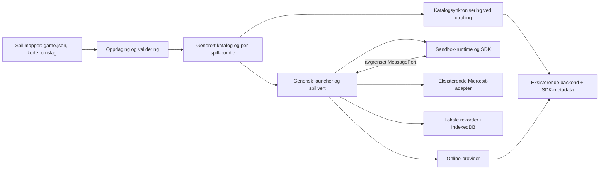

# Refaktoreringsplan

**Status:** Refaktoreringen er implementert lokalt 2026-11-04. Alle syv spill er migrert; faktisk databaseutrulling og fysisk akseptanse gjenstår. [Valideringsrapporten](../../results/cartridges-validation.md) gir evidens og begrensninger. Planen dokumenterer gjennomført arkitektur og leveranserekkefølge.

## Dagens koblinger som må fjernes

Utgangspunkt før refaktoreringen (tabellen er beholdt for sporbarhet):

| Sted | Nåværende ansvar/kobling | Mål |
| --- | --- | --- |
| `src/games/registry.js` | Syv familier, 47 varianter, importgrener, racing-ID-er og spillspesifikk formatering. | Generert katalog og generisk scorecodec/formatter. En tynn kompatibilitetsfasade kan beholdes under migrering. |
| `src/app/play.js` | Spillnøkler bestemmer kontrolltekst, oppsett, lyd, resizing, logo, recovery, score og avslutning. | Generisk hostcontroller; metadata/SDK og lokal spillkode eier forskjellene. |
| `src/app/main.js` | Tillatte spillruter fra synkront family-register; login-gating før gamePage. | Asynkron oppdaget katalog; separat lokal/online-startpolicy. Gamle ruter får manifeststyrte aliaser. |
| `src/app/arcade.js` | Familievisning og omslag er knyttet til eksisterende familier; sidebar leser online API. | Omslag/metadata fra manifest; sidebar leser valgt leaderboard-provider. |
| `src/app/style.css` | Sentrale importer av spillstiler. | Bare hoststiler globalt. Spillstiler lastes i egen ramme fra pakken. |
| `src/microbit-input/` | Sideeid port og spillavgrenset input/output fungerer allerede. | Behold implementasjon og protokoll; bygg en avgrenset SDK-bro rundt spillsesjonen. |
| `src/platform/{rules,submissions}.js` | Kontoeide forsøk, safe integer, minnebasert retry-kø. | Gjenbruk online-reglene bak provider; legg til lokal rekordprovider. |
| `verification/{build,serve-app}.js` | Statiske kopier og MIME-liste uten bilde-/lydformater. | Skann/valider/kompiler spill, generer katalog, tilby riktige MIME-er og utviklingsoppdatering. |
| `verification/catalog-commands.mjs` | Skriver manuelle vedlikeholdskommandoer per variant. | Erstatt normalflyten med én generert katalogsynkronisering per utrulling. Behold eventuelt gammelt verktøy til feilsøking. |
| Backend Game/API/AI | Eksisterende heltallskontrakt og enkelte spillspesifikke formattere. | Behold lagringssemantikk, legg til deklarativ SDK-metadata/codec og katalogsynkronisering. |

## Målarkitektur



Levert intern inndeling (ikke offentlig importflate):

```text
webapp/src/game-sdk/       offentlig defineGame, typer, runtime-fasade
webapp/src/game-host/      katalog, livsløp, iframe-bro, validering
webapp/src/leaderboards/   comparator/codec, lokal/online-provider
webapp/src/games/<game>/   hele spillets manifest, kode og ressurser
webapp/verification/      felles discovery/build/pack/check-verktøy
webapp/templates/         kopierbar spillmal, uten runtime-duplisering
```

## Oppdaging, bygg og utvikling

Utviklingsserveren skanner bare direkte undermapper av `src/games/` med `game.json`. Valider metadata og filreferanser før kompilering. Et låst, felles ES-modulbyggverktøy skal samle hver pakke til én modul med SDK-importen som ekstern. esbuild, Ajv og Acorn er låste utviklingsavhengigheter; ingen spillutvikler trenger egen buildkonfigurasjon eller runtimeavhengigheter. Bruk parser/resolver til importkontroll, aldri regex som generell JavaScript-parser.

Katalogen sorteres deterministisk og inneholder manifest, moduser, nødvendige URLs, innholdshasher og utledede toppliste-ID-er. Den kopieres til `dist` sammen med spillbundler/ressurser og SDK-runtime. Utviklingsserveren tilbyr samme katalogformat med revisjonsnummer/ETag. Launcher oppdaterer ved start, tilbakevending til velger og «Oppdater spill»; filwatch/SSE kan gi øyeblikkelig beskjed uten å være nødvendig for korrekthet. Ingen endring skyves inn i aktiv spillkode; en runde eier sin hash og modus til avslutning.

Utvikling viser valideringsfeil per mappe og lar andre gyldige spill starte. Produksjonsbuild feiler ved ugyldig installert pakke eller ID-konflikt, slik at feil ikke publiseres som et usynlig manglende spill. Ingen publisert katalog skal kreve en kataloglisting fra webserveren. `file://` er ikke støttet; bruk lokal HTTP-server eller HTTPS som i dagens app.

## Sandbox og bro

Felles profil for alle migrerte spill: iframe med `sandbox="allow-scripts"`, uten `allow-same-origin`, popups, skjemaer eller top-navigation. En hosteid bootstrap oppretter dokument, SDK og kompilert spillmodul som lokale blob-ressurser; importmap binder bare `@microbit-games/sdk`. Spillkoden får verken vanlig hostimport eller tilgang til parent-objekter. Validerte bytes for ressurser sendes gjennom broen; et game-manifest kan ikke endre sandbox-/CSP-politikken.

CSP begrenser skript til runtime-bootstrap og lokale blob-moduler, styling til spillstiler, bilder/media/fonter til lokale blobs og validerte data-bilder. `connect-src`, `worker-src`, `frame-src`, `object-src`, `form-action` og `base-uri` settes til `none`. Ingen `eval` eller eksterne importer. Rammen får ikke direkte Serial-, kamera-, mikrofonopptaks- eller geolokasjonstillatelser; Micro:bit-mikrofonen er en SDK-sensor, ikke nettleserens opptakstillatelse.

Start håndtrykket mot den konkrete `iframe.contentWindow`, overfør én MessagePort og bind den til tilfeldig runtime-epoch og rundetoken. En opaque iframe-origin kan være `null`; sjekk av bare `event.origin` er derfor utilstrekkelig. Ingen generelle window-meldinger godtas etter håndtrykk. Vertens dispatcher validerer operasjon, payload, aktiv epoch og låst toppliste. Sene meldinger, ekstra porter og metode-/ID-manipulasjon avvises. Frakobling lukker porten og avviser utestående kall.

Dette bygger på [HTMLs sandboxregler](https://html.spec.whatwg.org/multipage/iframe-embed-object.html) og [Chromes veiledning om opaque origins og meldingskilder](https://developer.chrome.com/docs/modern-web-guidance/guides/security/validate-origins). Valg av blob-/importmap-bootstrap skal bevises i et tidlig Chromium-spike før SDK-et låses. Ikke løs en lastingsfeil ved å legge til `allow-same-origin`. [Import maps](https://developer.mozilla.org/en-US/docs/Web/HTML/Reference/Elements/script/type/importmap) er moduloppløsning, ikke i seg selv en sikkerhetsgrense.

Sandbox er en grense mot vertens data, ikke garanti mot nettleserfeil, uærlig score eller all ressurs-/nettverksbruk. En iframe kan fortsatt forsøke egen navigasjon, og JavaScript kan bruke for mye CPU; overvåk uventet load, fjern rammen ved avvik og ha en synlig stopp-/tilbakestillingshandling. Ikke lov sikker kjøring av vilkårlig fiendtlig kode. Felles nettlesertester må undersøke reell CSP, cookies, nettverk, popups og top-navigation, ikke bare at `sandbox`-attributtet finnes.

## Lokale rekorder

IndexedDB på vertens origin lagrer rekorder; sandboxen får ingen databasehandle. En record har `boardKey`, `nameKey`, `displayName`, strukturell `score`, `recordedAt` og forsøks-ID. Primærnøkkelen er `(boardKey, nameKey)`. Sammenlign-og-oppdater gjøres i én readwrite-transaksjon; bekreft først på transaksjonens complete-event, ikke ved enkeltrequestens success. Bruk delt rangering 1,1,3 og `nameKey` som stabil sekundærsortering. Tidspunkt er lokal UTC-informasjon, ikke tillitsbevis eller tie-breaker for plassering.

Lageret har egne versjonerte schema-migreringer. Faner varsles gjennom BroadcastChannel om ny rekord; ved manglende støtte oppfriskes ved fokus/manuell refresh. Lesning og antall kommer fra samme transaksjon. Oppdatering kan ikke miste en bedre rekord i konkurranse mellom faner. Like/dårligere scorer krever ingen ny rekordrad.

Resultatdialogen lever i verten og beholder ferdig resultat/lagringsforsøk i minnet mens brukeren skriver navn eller prøver lagring igjen. Ny runde eller navigering med uløst navnefelt krever et tydelig «Fortsett uten å lagre»-valg. Ingen automatisk lagring under forrige spillers navn. Eksport/import av rekorddata er et eget JSON-format med `formatVersion`, topplistenøkler, scoredefinisjonens fingeravtrykk og rader; dette er **ikke spillimport**. Ukjent spilldata kan beholdes som arkiv etter validering, men skal ikke vises på en annen toppliste. Oppdateringer/import flettes i én transaksjon med samme beste-score-regel.

Lagring er knyttet til nettleserprofil, scheme, hostname og port. `localhost:4174` og `127.0.0.1:4174` deler ikke database, og to maskiner som besøker samme lokale server har hver sine lokale rekorder. Dette skal stå nær eksportfunksjonen. Nettleseren kan slette data/avvise kvote; [IndexedDB-transaksjoner](https://developer.mozilla.org/en-US/docs/Web/API/IndexedDB_API/Using_IndexedDB) og [lagringskvoter](https://developer.mozilla.org/en-US/docs/Web/API/Storage_API/Storage_quotas_and_eviction_criteria) begrunner behovet for eksplisitt feil og eksport.

## Leveransetrinn og akseptanse

| Trinn | Arbeid | Ferdig når |
| --- | --- | --- |
| 1. Frys kompatibilitet | Ta referanse for alle 47 ID-er, scoregrenser/codecs, ruter og sentrale spillforløp. Beskriv endringene til API-kontrakt og oppdaterte krav. | Maskinlesbar før/etter-fasit og regresjonstester finnes; ingen produksjonsdata flyttet. |
| 2. Manifest og discovery | Implementer schema/semantisk validator, generert katalog, cover/MIME, generisk modusvelger og dev-refresh. | En ny metadata-/eksempelmappe vises uten redigering av register eller globale stiler. |
| 3. Sandbox-spike og SDK | Bevis modulbootstrap, input/output-bro, pause/disposal, lydbrukerklikk og fullscreen. Deretter implementer stabil SDK-flate. | Isolasjon og seriell semantikk er testet i ekte browser; ingen lemping av sandbox for å laste moduler. |
| 4. Lokale rekorder | Felles comparator/codec, IndexedDB-provider, navneflow, topplisteside/sidebar, eksport/import/sletting. | Første/bedre/lik/dårligere score, to faner, kvotefeil og omstart oppfører seg etter kravene. |
| 5. Online og utrulling | Backend-metadata/migrering, decoder-validering, én katalogsynkronisering og oppdatert OpenAPI/AI-presentasjon. | Nytt spill får online-toppliste ved vanlig utrulling uten manuell variantregistrering; eksisterende data/ID-er er identiske. |
| 6. Migrer enkle spill | Flytt Stars, Reaction og Balance til manifest/SDK; legg til omslag og lokale spillhjelpere. | Ingen nye hostgrener; tidligere regler og resultater består referansetestene. |
| 7. Migrer øvrige spill | Snake, Viking, Tetris og Racer med egne setup-/audio-/output-/recovery-regler og legacy-ID-er. | Alle syv spill kjører gjennom samme host. Tetris hold/lyd, Racer 36 moduser/kamera og Snake-rangering er bevart. |
| 8. Fjern overgangskode | Fjern manuelle registry/lazy-load-grener og spillimporter i host/CSS. Flytt nødvendige shared helpers til SDK eller inn i spillene. | Et nytt spill trenger bare sin egen mappe, også når det har flere moduser, lyd og device-output. |
| 9. Dokumenter og aksepter | Lever faktisk kjørbar mal/guide/verktøy, pakk et nytt spill, installer i ren lokal kopi og publiser til testmiljø. | [Testplanen](test-plan.md) har evidens, inkludert fysisk Micro:bit-akseptanse og lokal/online-rangering. |

Trinn 2–5 kan utvikles før alle gamle spill er migrert. Under overgangen kan et internt legacy-hostgrensesnitt brukes for gamle spill; det skal ikke være del av det nye offentlige API-et. Påstå ikke full isolasjon for gamle spill før de faktisk er flyttet til sandboxen.

## Omfang og utrullingsport

Implementasjonen leverer kode, låste byggavhengigheter, database-migrering 002 og oppdatert dokumentasjon. Faktisk deploy/databaseendring er ikke utført. Implementeringen bør leveres i små reviewbare endringer i rekkefølgen over. Behold bakoverkompatibel API/driftsrekkefølge og en fungerende lokalapp mellom trinnene. Produktguiden og malen beskriver de leverte kommandoene og SDK v1.
