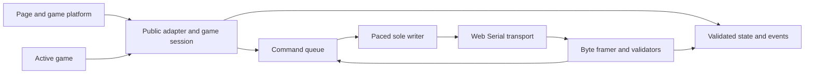

# JavaScript micro:bit Input Library Implementation Plan

## Status and Scope

Implemented 2026-10-28: a local, framework-independent **JavaScript ES module library** under `webapp/src/microbit-input`, supporting the current micro:bit V2 protocol, with software tests, browser mocks, replay benchmarks and a two-game example. See the [usage guide](../src/microbit-input/README.md) and [validation record](../results/game-input-validation.md). Physical browser/V2 verification remains outstanding. No npm publication or runtime framework dependency is required. Node.js and browser automation are development tools, not requirements installed by game players.

The page owns one adapter and one serial port. Games receive the existing session-bound input/output facade. Include connection/recovery, framing/validation, normalized state, counted presses, derived inputs, commands/results, subscriptions, and disposal. Backend requests, authentication, scoring, saving results, router selection, and individual game rules remain outside the library.

Authoritative inputs:

- [Serial protocol](../../spec/contracts/microbit-webapp/microbit-serial-protocol.md): wire schema, limits, framing, version/board checks, deadlines, ID rules, output semantics.
- [Developer interface](../../spec/contracts/microbit-webapp/web-page-developer-interface.md): public methods, state, events, formulas, defaults, and ownership.
- [Component specification](Komponentspesifikasjon_webapplikasjon_forklart.md): mandatory connection before play, pause on lost input, user-controlled continuation, and result handling by Spillplattform.
- [Test plan](game-input-test-plan.md) and [shared fixtures](../../spec/contracts/microbit-webapp/fixtures/README.md): verification cases and expected outcomes.

Implement the shared definitions directly. Do not invent per-game wire formats, sensor-selection commands, a V1 fallback, or alternate timeout/gesture defaults. Keep a small code constants table traceable to the serial contract; change the contract, constants, and fixtures together when changing behavior. Phases 1–6 have software implementations and passing automated checks. Phase 7 has replay benchmarks; real permission/USB/V2 checks, physical latency and a real-time soak remain unassessed.

## Delivery Approach and Tooling

Use `.js` modules with explicit relative imports/exports and JSDoc typedefs for metadata, snapshots, public state, events, and errors. Keep the public import stable at `webapp/src/microbit-input/index.js`. Export the page singleton as `microbit`; retain an internal adapter factory for isolated tests. Importing modules must not prompt, open ports, register global listeners, or access browser-only globals eagerly.

Use zero third-party runtime dependencies initially. In particular, the small bounded protocol does not require a framework, state-management package, or Node serial library. Keep internal functions testable with injected dependencies. TypeScript or a framework hook is a later wrapper/migration decision, not a prerequisite for this release.

Development baseline: native Node.js test runner with `node:assert/strict` for unit/fake-transport tests, and Playwright for browser integration. Locally verified versions are Node 24.22.1, npm 11.19.1, Playwright 1.64.1 and Chromium 156.0.8078.4 (Playwright revision 1248); package/lock files pin the tools. The [Node test runner](https://nodejs.org/api/test.html) and [Playwright browser API mocking guide](https://playwright.dev/docs/mock-browser-apis) document those capabilities.

Browser reference target is a recorded desktop Chromium-based browser with working Web Serial, tested on the team's actual OS/device combination. This is a verification target, not a compatibility claim for all Chromium browsers or mobile platforms. Feature-detect Web Serial/secure context and report unsupported environments clearly. The [Web Serial specification](https://wicg.github.io/serial/) and [Chrome integration guide](https://developer.chrome.com/docs/capabilities/serial) are implementation references; browser permission UI and real USB behavior still need manual checks.

## Module Layout

These paths exist relative to `webapp/src/microbit-input`; `types.js` additionally holds JSDoc records. Preserve responsibility boundaries rather than creating a class for every row.

| Module | Responsibility |
|---|---|
| `index.js` | Stable public singleton export; no connection side effects |
| `adapter.js` | Composition, connection lifecycle, port selection, session epochs, readiness, recovery, error routing |
| `transport/web-serial.js` | Browser API boundary: request/open/read/write/cancel/close, port events, stream locks, transport errors |
| `transport/paced-writer.js` | Sole outbound writer; ordered ASCII chunks, pacing, partial-write/unknown-outcome handling |
| `protocol/constants.js` | Wire constants/error names traceable to contract; distinct from internal resource budgets |
| `protocol/line-framer.js` | Bounded byte-based LF/CRLF framing, ASCII validation, overflow discard and resynchronization |
| `protocol/messages.js` | JSON-object/duplicate-key checks, metadata/snapshot validation, result parsing, command encoding |
| `inputs/state.js` | Immutable current state, atomic sequence/time/counter acceptance, public field mapping, unavailable shape |
| `inputs/derived.js` | Pure tilt/strength functions and clock-driven shake/sound-label history |
| `outputs/commands.js` | Local argument/capability validation, owned queue records, IDs, result correlation, caller settlement |
| `sessions.js` | One active game, subscriptions, baseline reset, disposal fencing, STOP/CLEAR cleanup |
| `errors.js` | Stable error shape and callback-error isolation |

Inject a transport factory, monotonic `clock.now()`, timer scheduling/cancellation, and test diagnostics through the internal factory. Default production dependencies are supplied lazily by the adapter. Tests must not change production globals or require real timers to prove timeout behavior.

## Critical Implementation Rules

### Byte Stream and Validation

Operate on received `Uint8Array` chunks before decoding. Enforce the device-to-host byte limit with only the allowed extra final-CR slot; LF is consumed separately. Report one overflow, discard through LF, and then resume. Do not retain an unbounded accumulator, a complete read-history array, or a message queue between reads. Process all complete lines in order, including multiple samples in one chunk.

Check every payload byte against the wire ASCII rule before converting it to text. Do not silently replace invalid bytes with a decoder replacement character or normalize arbitrary whitespace. Validate based on connection phase and message prefix; an untyped object is a snapshot candidate, not automatically valid state.

`JSON.parse` alone cannot enforce the protocol's unique-key requirement. Add a bounded duplicate-key-aware JSON object scanner before parsing, or an equivalently tested parser. It must understand object/array nesting, string escapes, and decoded key equality; searching for repeated text with a regular expression is insufficient. Include duplicate nested metadata keys and escaped equivalent keys in tests. Keep this implementation confined to the line limit and avoid interpreting arbitrary object properties as application state.

Read required fields as own properties, require actual integer number values/ranges, and build normalized state from an explicit field list. Never spread/merge untrusted parsed objects into adapter/session objects or prototypes. Unknown allowed fields may be ignored without exposing them through the game facade.

Validate shape, forward sequence/time, and all press deltas before committing any baseline, state, freshness timestamp, or event. Use the contract's explicit modular arithmetic in JavaScript numbers; signed bitwise operations must not turn unsigned counters above `2^31` into negative sequence values. First-session and first-game samples establish event baselines without replay. Device `u` drives classification; host monotonic time drives liveness. A timer callback must recheck actual elapsed monotonic time and operation epoch before acting.

### Lifecycle and Resource Ownership

Internally distinguish idle, choosing port, opening, awaiting info, awaiting first sample, ready, recovering, and closing. Project those onto the contract's three public connection values. Keep one reader loop and one writer owner; connect/disconnect/dispose operations are idempotent as specified. Before readiness, output calls reject locally.

Invoke `requestPort()` through the page's user action without awaiting unrelated work first. Do not invent a fixed USB vendor/product filter before verifying the real V2 interface descriptors. Validate board identity in `deviceInfo`; a USB descriptor does not establish firmware conformance. Browser recovery on an already-open port sends `HELLO` without another chooser; physical removal does not trigger an unsolicited permission prompt.

Use a monotonically increasing internal connection epoch and game-session identity. Every asynchronous read/write continuation, deadline, chooser completion, and cleanup action checks the identity it belongs to. A stale completion may clean up its own resources, but cannot publish state or close a newer connection. Explicit disconnect invalidates recovery before cleanup. Do not wait indefinitely for an unabortable chooser: cancel the logical connect operation, fence its eventual result, and allow only one outstanding native chooser at a time.

The protocol deadlines begin at their specified points, not when the caller clicks. In addition, use the implemented internal 3000 ms watchdog for selected-port open/write/teardown operations so a never-settling browser promise cannot leave startup or disposal hanging forever. This is a local transport safeguard, not a wire timeout replacement; do not time out a user while the chooser remains open. Fence late completions, retain their cleanup responsibility, and report incomplete resource release rather than claiming a successful close.

The reader loop must end/cancel before releasing its lock; the writer must drain or fail its current operation before release; only then close the port. Implement the actual ordering against the selected browser/Streams APIs. Account for EOF, read errors, unplug events, canceled reads, rejected writes, and close failures without double settlement or unhandled rejections. Do not rely on page-unload handlers completing asynchronous STOP/CLEAR; explicit user navigation/disconnect uses awaited cleanup, while abrupt page exit remains best effort.

For a recoverable browser read error, release the failed reader and acquire the port's current readable stream before attempting the recovery handshake. If the port is no longer readable/usable, follow fatal-disconnect handling instead. Reset partial framing at that recovery boundary and do not allow an old reader's delayed completion to publish into the replacement loop. Test stream recreation as well as physical removal.

### Commands and Recovery

Validate arguments/capabilities, copy caller-owned arrays/objects into an immutable command record, and enqueue only for the current active game. Otherwise a caller could mutate a queued image/melody after validation. Apply one in-flight command plus the bounded waiting queue from the wire contract. No UI callback writes serial bytes directly.

At write start assign the next ID and register correlation before awaiting the first write; a fast result must not race pending-call registration. Arm the result deadline only after the LF write completes, and do not install a timer for an already-settled operation. Preserve pacing across bootstrap, commands, partial-line termination, cleanup, and recovery. `OK` means started/applied, not playback completion.

A timeout/write failure makes execution unknown. Reject affected old calls, block normal writes, and perform one recovery handshake without replay. Where a partial line may exist, finish its delimiter before `HELLO` according to the contract. Ignore/report old pre-barrier traffic, reset baselines on the new info boundary, and require the first valid sample again. ID exhaustion also requires a fresh session before another command. Cleanup commands use the same writer/ID machinery without being blocked by the disposed game's own queue.

### Game and Platform Integration

The library reports connection/input state and events; Spillplattform decides pause/resume, game rules, scores, and backend saves. Ordinary game launch is blocked until both `connected` and `inputAvailable` are true. The local Testlab tool may open its connection UI without a backend or device connection; it creates its adapter game session only once the adapter is ready, and never submits results or renews an account session. A lost/stale connection immediately publishes safe unavailable state; platform code pauses the game and offers reconnect/exit. A recovered connection does **not** automatically continue game simulation: the player chooses to continue. Game state remains owned by the platform/game while paused.

Unexpected physical loss retains the current logical game facade/subscriptions in a suspended state so page-level `connect()` can attach a replacement V2 session. Reconnect resets sensor/event history and cannot replay prior commands or presses. Explicit page `disconnect()` continues to dispose the game. Disposing after the port is already gone releases local resources without waiting for impossible device acknowledgements; it does not claim the removed board was stopped. These lifecycle clarifications are documented in the developer interface and tested with the reconnect flow.

Create only one active game session. Switching/ending an active game awaits `dispose()` before mounting another; disposal rejects old work immediately, drains an already-written command internally, then acknowledges STOP/CLEAR while connected. Removed subscriptions, stale promises, and late serial results cannot affect the next game. If connected cleanup fails, close and report failure as specified; the platform still handles its result-save decision independently.

The component specification's informal button example maps to the real `onPress({ input, count })` contract; it is not an extra wire/event format. Hold controls use current state. Recovering event counts does not reconstruct exact physical ordering or release events. A framework wrapper may subscribe/unsubscribe around this library later without owning another port.

## Ordered Implementation Phases

Each phase produces reviewable code/tests and updates runnable commands/status in the module README. Do not publish a partial facade as production-ready just because a mocked demo moves a player. Later phases retain earlier checks; extend the existing test IDs instead of inventing a separate acceptance scheme.

| Phase | Work and deliverables | Completion gate / test coverage |
|---|---|---|
| 1. Scaffold and test seams | Create module entry/internal factory, constants/JSDoc/error types, webapp package/lock configuration, pinned development environment, native test runner, fake clock, fake transport, and fixture loader. Define future npm scripts. | Module imports in browser and Node without prompting or touching an absent `navigator`; isolated instances do not share listeners/timers. Test setup can run without a board. |
| 2. Framing and protocol | Implement bounded byte framing, duplicate-key-aware JSON checks, strict V2 metadata/snapshot/result validation, and command encoding for every action/default. Run relevant shared sections plus generated boundary cases. | GI-02, GI-03, GI-05, GI-06, GI-11, GI-14; overflow resynchronizes; malformed input cannot modify valid state. Golden encodings match fixtures. |
| 3. State and events | Implement atomic snapshot acceptance, wrap/gap diagnostics, counted presses, immutable state, subscriptions, tilt/strength/shake/sound derivation, and unavailable/reset shape. | GI-04, GI-06, GI-07, GI-08, GI-09, GI-19; individual versus batched sample replay yields identical events; subscriber failures and mutations are isolated. |
| 4. Transport and connection | Implement real Web Serial boundary, lazy feature checks, paced sole writer, handshake barrier/readiness, resource cleanup, epochs, deadline/freshness handling, and one-attempt recovery using the fake transport first. | GI-01, GI-02, GI-10, GI-16, GI-20; info without sample stays unready; continuing results/invalid lines cannot keep inputs alive; late operations cannot revive a canceled connection. |
| 5. Commands and game sessions | Connect validated/copy-owned queue records to IDs/results; handle timeout, partial write, overload, exhaustion, disposal, cleanup bypass, and logical game retention across unexpected loss. | GI-11, GI-12, GI-13, GI-17, GI-18, GI-20; no duplicate action/reused ID, unknown result cannot settle current work, disposed work cannot leak into a later game. |
| 6. Browser/platform example | Add a small local ES-module example with connection/status controls, state view, input events, display/sound controls, and two fake games. Integrate launch/pause/reconnect/user-resume/dispose behavior with mocked Web Serial in Playwright. | GI-09, GI-10, GI-14, GI-16, GI-17, GI-20 plus product integration checks below; the browser example works without selecting a frontend framework. |
| 7. Physical V2 and benchmarks | Test real permissions/USB and firmware, run smoke/output/interruption/reconnect cases, measure normal/stress propagation and end-to-end behavior, and retain reports. | GI-15, GI-18 plus benchmark gates in the test plan/API; unsupported/missing hardware is reported accurately. All unverified combinations remain labeled. |

Phases 1–6 can advance without firmware or a connected board. Phase 7 requires a V2 firmware artifact conforming to the shared contract; coordinate with its [implementation design](../../microbit/spec/firmware-implementation.md) and recorded firmware results. A raw upstream CODAL sample does not satisfy that prerequisite.

## Test Layout, Scripts, and CI

Tests under `webapp/tests/microbit-input` are `protocol.test.js`, `lifecycle.test.js`, `native-streams.test.js`, `browser/`, and `support/`. Fake transport/clock/fixture helpers stay outside production source. Playwright mocks are installed before the page imports the library. Those mocks test adapter integration, not the operating system permission chooser or real USB; manually verify those on supported hardware/browser combinations.

These commands are runnable from `webapp` after installing the pinned development tools. Install Chromium once with `npx playwright install chromium` before browser tests:

| Command from `webapp` | Purpose |
|---|---|
| `npm ci` | Install pinned development dependencies from the committed lockfile |
| `npm test` | Native Node unit and fake-transport suites; no physical device |
| `npm run test:browser` | Playwright tests against a local server and mocked Web Serial |
| `npm run dev:input` | Serve the standalone input-library example locally with the correct ES module MIME types |
| `npm run benchmark:input` | Recorded-fixture normal/stress processing and propagation measurements |

The development/example server uses Node's built-in HTTP/file APIs. It is only a local development tool. The deployed page imports the static modules normally; the runtime library has no production Node server or backend dependency.

The added `.github/workflows/webapp-input.yml` runs unit/fake-transport tests, browser mocks and replay benchmarks without hardware; its remote execution has not been verified in this local delivery. A hardware job/manual run is separate. Missing hardware never skips software suites, while absent permission/API scenarios remain testable with mocks. Preserve failure reports/traces for browser cases and record source/fixture/tool/browser versions. Timing gates are the existing shared targets; do not reset them after a failing run. Browser event-loop delays/background suspension must mark input unavailable before the next game callback rather than processing a stale deadline as fresh state.

Before each implementation phase is accepted, exercise the relevant behavioral tests rather than only checking helper return values. Important races include disposal during a write, a result before write completion, disconnect while selecting/opening, an unresolved writer promise, callbacks that unsubscribe/dispose during notification, and recovery while old read completions are pending. Fake clocks must not leave pending timers/listeners when a case ends.

## Example and Platform Acceptance

The implemented example is `webapp/examples/microbit-input/index.html`, served from a local webapp-root server. It imports the same production entry used by games. Browser tests inject mock Web Serial before import; the normal example requests a real device. A mock connection must never satisfy the platform's real-device game-start requirement in production. The example demonstrates the input lifecycle; account/backend result flows remain outside this library delivery.

Acceptance requires demonstrating:

1. Two small games use exactly the same input/output facade and have no Web Serial/parser code of their own.
2. Start remains blocked before handshake plus first snapshot; missing/unsupported boards produce a usable error, not fabricated input.
3. Held controls neutralize and the game pauses on silence/removal. After reconnect, input baselines are fresh and simulation resumes only on the player's choice.
4. Disposing game A removes its subscriptions, commands, and output before game B starts; B receives no historical actions. A lost port can be disposed locally without hanging exit/navigation.
5. Exiting a paused game passes the decision to the platform's existing unfinished-result/save flow. The library itself makes no backend call and never changes score/completion status.
6. Explicit cleanup releases the port for a subsequent real connection; abrupt termination is reported as best effort, not guaranteed STOP/CLEAR.

## Definition of Done and Remaining Integration Records

The library is complete when every public method/error/state in the developer interface is implemented, the shared/extended software cases pass, the platform example meets the product flow, resource/queue bounds are demonstrated, and required browser/V2 performance and smoke results are recorded. A fixture pass alone is not hardware verification. Document any unavailable hardware or uninstrumented latency as skipped/unassessed rather than passed.

Record actual Node/package-manager/Playwright/browser pins, local-server command, supported browser/OS/V2/interface/firmware combinations, package scripts, example usage, benchmark method, and known limitations in the webapp README/results. Those environment records are first-implementation deliverables, not unresolved choices about wire/API behavior. Do not introduce public API changes or alter protocol constants to work around an implementation failure without updating the shared documents and fixtures.
